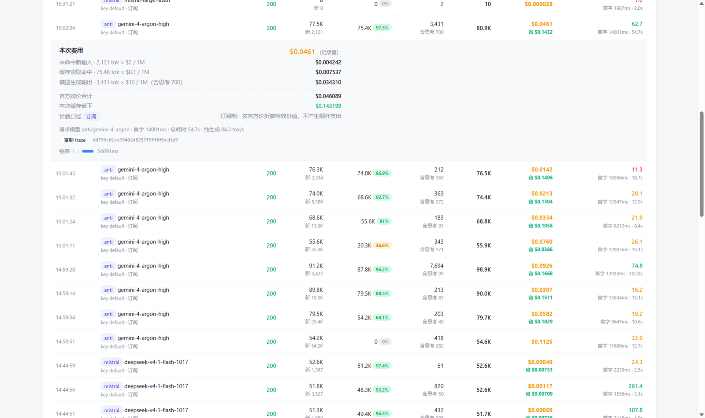
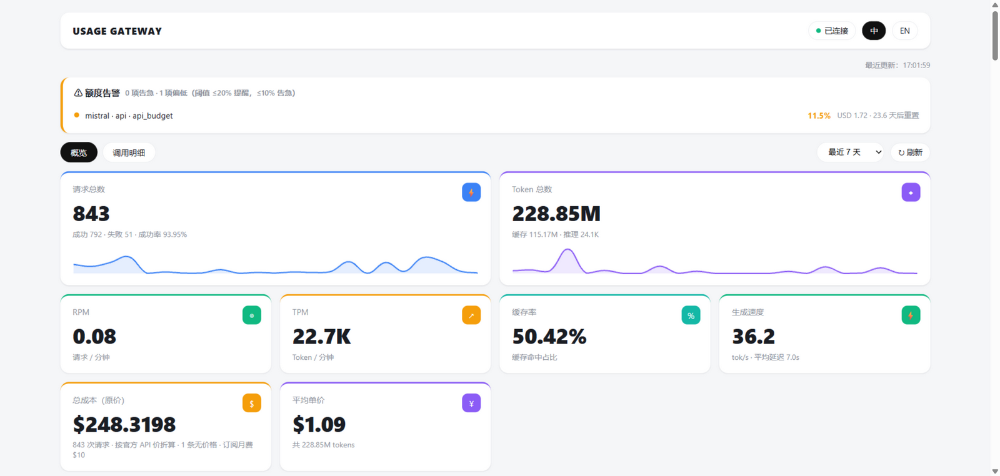
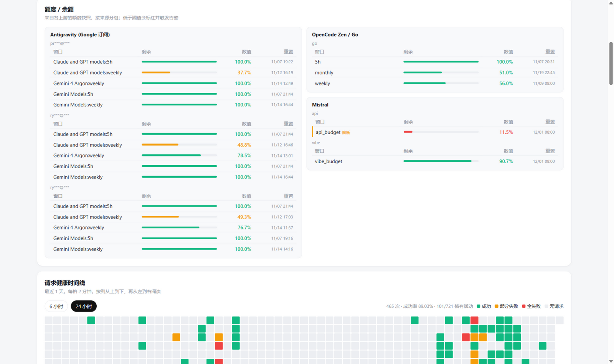
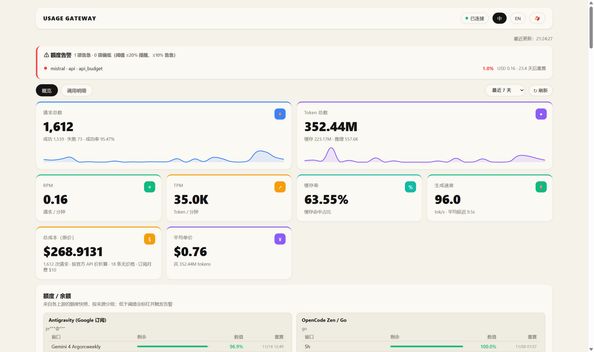
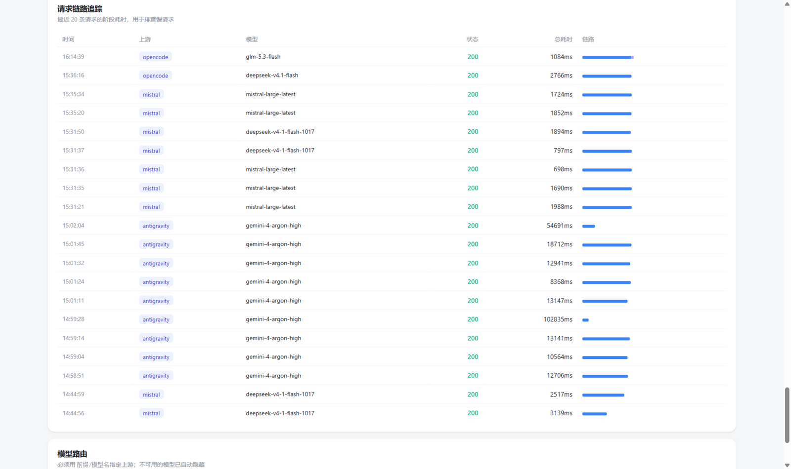
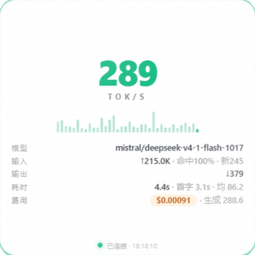

# Usage Gateway

[中文](README.md)

[](https://github.com/Qiongkura/usage-gateway/actions/workflows/ci.yml)


A local-first multi-upstream LLM gateway: **clients only see the keys you issue** — upstream
keys never leave the server. Every call is metered into a per-call ledger with itemized cost,
cache-hit savings, and a built-in web dashboard.

```text
Clients (OpenAI / Anthropic SDK)               Upstreams
      │  sk-gw-xxxx                 ┌──────────────────────────────┐
      ▼                             │  Antigravity Tools  (sub)    │
┌──────────────────┐   prefix route  │  Mistral API        (sub)    │
│  usage-gateway   │ ─────────────▶ │  OpenCode Zen       (sub)    │
│  :9000           │                │  New API relays     (free)   │
└──────────────────┘                │  ...custom                   │
      │        ▲                    └──────────────────────────────┘
      │        └── collectors: quota snapshots, local client logs
      ▼
  Web dashboard + SQLite (per-call ledger / tracing / heatmap / alerts)
```

## Screenshots

**Per-call ledger: open any row to see the itemized bill and how much prompt caching saved**



**Overview: summary cards, trends, 365-day activity heatmap**



**Subscription quota cards across accounts (5h / weekly windows with reset times)**



**Warm-paper theme (light / dark / warm — one-click switch)**



**Trace waterfall: per-stage latency for slow-request debugging**



**tok/s widget (frameless, always-on-top, draggable / pinnable / closable): live generation speed + last call**



## Features

**Proxy core**
- OpenAI & Anthropic compatible (`/v1/chat/completions`, `/v1/messages`, `/v1/responses`, `/v1/models`)
- Strict prefix routing (`alias/model`) — never silently switches channels (protects cheap pools)
- Upstream health circuit breaker with exponential cooldown; optional same-alias failover
- Compat layer: array-content flattening, tool-call chunk normalization, developer-role rewrite,
  strict-schema param whitelisting, auto `include_usage`, non-stream → SSE wrapping
- Connection pooling with 5-minute keepalive
- Ordered multi-key chain per upstream (402 / 429 → next key, 15-minute cooldown); single-key configs still work
- Periodic model probes are hot-applied without restart; confirmed missing models are hidden. Probes send real minimal generation requests to upstreams and can incur charges or consume quota. `probe_days` defaults to 7; set it to 0 to disable automatic probes (manual probes remain available). Cooldowns and a shared probe lock live in `data_dir`: instances must persistently mount the same directory and run a version supporting this lock. Across hosts, the filesystem must correctly support OS file locks. The legacy project-root lock also protects older processes in the same project directory, but older versions in separate directories do not honor the shared lock. Health snapshots remain in each project root and are not automatically synchronized to other instances; a shared database watermark does not propagate their hot-applied results.

**Per-call ledger**
- Every call records: uncached input / cache read / cache write / output (incl. thinking) /
  status / TTFT / total latency / tok-s
- Itemized bill per call: input + cache-read + cache-write + output × time multiplier,
  plus **how much money the prompt cache saved you**
- Call Logs view: filters (time / channel / key / origin / status / model search), summary bar,
  pagination, CSV export
- Costs are always converted at official API list prices; subscription / free channels are tagged
- Upstream-reported costs (e.g. Zen `list_cost`) take precedence; historical records can be backfilled
- Daily rolling database backup (`VACUUM INTO`, keep 7)

**Dashboard**
- Summary cards, composition / cost / request trends, 365-day heatmap, request health timeline
- Compact multi-account quota cards with reset times, quota alerts (desktop + webhook, state machine)
- **Burn-rate projection**: each window's rate in percentage-points/hour, projected remaining at reset;
  warnings may indicate depletion before reset; when reset time is unknown, the linear estimate does not account for reset.
  No more treating `99% left in a 5h window` as dozens of days. This linear extrapolation uses recent snapshots; insufficient, stale or reset-crossing samples are not extrapolated. Bursts and upstream reset behavior can make it inaccurate; it is not a quota guarantee.
- Absolute balance thresholds can be configured per source and currency and are disabled by default. Relay cumulative spend is not a remaining balance and does not trigger balance alerts. Unknown or stale items are not counted as OK; `/api/alerts` reports `counts.unknown`. Disabling notifications does not change the configured classification thresholds used by `/api/quota`.
- Request trace waterfall, live tok/s widget (`/float`)
- Light / dark / warm-paper themes + zh / EN UI, both persisted locally

**Collectors** (read-only)
- Antigravity Tools (SQLite usage + per-account quota windows)
- Mistral billing (API / Vibe budgets), OpenCode Zen (5h / weekly / monthly)
- OpenCode CLI local database, Vibe session logs (incremental snapshots; asynchronous Vibe counters and collector deduplication can affect accuracy)

## Quick start

Python ≥ 3.10. Using [uv](https://docs.astral.sh/uv/):

```bash
git clone https://github.com/Qiongkura/usage-gateway.git
cd usage-gateway
uv sync
cp config.example.yaml config.yaml   # fill in your upstream + client keys
uv run python -m app.main
```

Dashboard at http://127.0.0.1:9000, API docs at `/docs`.

By default the server binds only to `127.0.0.1` using plaintext HTTP; there is no built-in user system or transport encryption. Optional `server.stats_key` protects statistics APIs, while `server.admin_key` protects administration, diagnostic export and upstream reset. Either key may be unset for a loopback-only bind. If `server.host` is changed to `0.0.0.0`, a LAN address or any other non-loopback address, the corresponding API fails closed with 503 until its key is configured. These permissions are separate from client API keys. Do not expose the service directly; for remote access configure a trusted reverse proxy with authentication, TLS and access controls, and replace the example client keys.

For non-ASCII keys, send UTF-8 percent-encoded values in `X-Stats-Key-Encoded` or `X-Admin-Key-Encoded` (use `encodeURIComponent` in JavaScript). Existing literal ASCII `X-Stats-Key` / `X-Admin-Key` headers remain supported. Encoded headers take precedence; the legacy admin query parameter is discouraged because URLs may be logged. Encoding is not encryption; use TLS for remote access.

## Docker

```bash
cp config.example.yaml config.yaml
# Edit config.yaml: set your keys and set server.host to 0.0.0.0 for container networking
docker compose up -d --build
```

Compose mounts `./data` (ledger database) and an existing `./config.yaml`; create the configuration first, because Docker may create a directory for a missing bind source. It publishes only to host `127.0.0.1:9000` by default. The container-side `server.host` must be `0.0.0.0`; in that mode both `server.stats_key` and `server.admin_key` are required, and an unconfigured API group fails closed with 503. Run `docker compose restart` after changing configuration or keys. For access from other hosts, explicitly change the port mapping and place the service behind a reverse proxy with authentication, TLS and access controls.

`/api/health` is the public liveness probe; `/api/ready` also checks the database and collection scheduler, and the Docker healthcheck uses it. Neither endpoint exposes keys, configuration or database content.

The build context excludes the default data directory, configuration, keys and common credential files. Before building, add any other custom data or credential paths inside the project to `.dockerignore`, or move them outside the project directory. Files not excluded are sent to the builder even if the Dockerfile does not copy them.

### Windows: autostart + app window

Drop a silent launcher into your Startup folder (`Win+R` → `shell:startup` → new `usage-gateway.vbs`):

```vbs
Set shell = CreateObject("WScript.Shell")
shell.CurrentDirectory = "C:\path\to\usage-gateway"
shell.Run "cmd /c if not exist logs mkdir logs", 0, True
shell.Run "cmd /c uv run python -m app.main >> logs\gateway.log 2>&1", 0, False
```

A second instance exits on the busy port, so running it again is harmless. For a chrome-less app window,
point a desktop shortcut at `msedge --app=http://127.0.0.1:9000/` (or Chrome).

## Client usage

Any OpenAI SDK:

```python
from openai import OpenAI

client = OpenAI(base_url="http://127.0.0.1:9000/v1", api_key="sk-gw-default-0001")
client.chat.completions.create(model="opgo/kimi-k3", messages=[...])   # prefix required
```

Anthropic SDK / Claude Code:

```bash
export ANTHROPIC_BASE_URL=http://127.0.0.1:9000
export ANTHROPIC_API_KEY=sk-gw-default-0001
```

## Configuration

See [config.example.yaml](config.example.yaml). Highlights:

| Key | Purpose |
|---|---|
| `gateway.client_keys[].allow_models` | per-key model whitelist |
| `upstreams[].alias` | model prefix (`alias: opgo` → `opgo/kimi-k3`) |
| `upstreams[].billing_mode` | `payg` / `subscription` (list-price equivalence) / `free` |
| `upstreams[].api_keys` | key chain: `api_key` first, then `api_keys` in order (402/429 → next key, 15-minute cooldown) |
| `upstreams[].no_proxy` | connect to local upstreams directly, bypassing the global proxy |
| `proxy` | outbound proxy for foreign upstreams |
| `failover` / `retry_rounds` | failover, off by default |
| `retention_days` | usage retention in days (default 365; 0 disables usage pruning); quota snapshots 3 days, traces 7 days |
| `probe_days` | automatic model probe interval in days (default 7; 0 disables automatic probes); probes incur real upstream usage |
| `server.admin_key` | independent key for admin, diagnostic export and upstream reset; prefer the `X-Admin-Key` header; required for non-loopback binds |
| `server.stats_key` | statistics read key, sent in `X-Stats-Key`; the dashboards prompt for it; required for non-loopback binds |
| `sse_heartbeat_sec` | SSE keepalive interval, disabled at 0 by default; cannot reduce upstream latency or override hard timeouts |
| `alerts.*` | quota alert thresholds, cooldown, desktop / webhook |

## Billing semantics

OpenAI `prompt_tokens` **includes** cached tokens — billing both in full double-counts.
The gateway normalizes:

```text
input_tokens  = prompt_tokens - cached_tokens    # uncached, input price
cache_read    = cached_tokens                    # cache price (usually 10-20x cheaper)
cache_write   = cache_creation_input_tokens      # cache-write price
output_tokens = completion_tokens (reasoning tokens folded in)
```

Prompt caching dominates long-context cost (measured 30-55x in practice); the gateway uses a stable cache-routing key for upstreams that need it (OpenCode Zen), but actual cache hits depend on the upstream.

### Session attribution and retention

Clients may explicitly send a single `X-Session-ID` of 1–128 ASCII letters, digits, `.`, `_`, `~` or `-`; invalid or duplicate headers are rejected with 400. The gateway computes an HMAC-SHA256 fingerprint scoped to the authenticated client name and source, stores the fingerprint rather than the original ID, and strips this header before forwarding. This is distinct from Zen's cache-routing header. Requests without it and historical or collector records without a fingerprint fall into an unassigned bucket; attribution is not inferred or backfilled.

At startup, the effective names of enabled `gateway.client_keys` entries must be unique or configuration loading fails. Comparison is case-sensitive and does not trim whitespace; missing or empty names retain the existing `key-<list index>` default, and entries without a key remain ignored. Resolve all duplicates before upgrading, including collisions between explicit and default names. The error does not print names or keys. Existing configurations with unique names and their fingerprints are unchanged; renaming a client prevents future fingerprints from matching records under its old name and does not repair previously merged history.

`/api/sessions` aggregates records in the selected filters. `cost_recorded_usd` sums only costs already recorded, without pricing missing values; `unpriced_requests` counts those missing costs. The total can therefore be incomplete and is not necessarily the actual upstream bill.

Usage records are retained for 365 days by default (`retention_days: 0` disables only usage pruning); quota snapshots are kept for 3 days and traces for 7. Pruning is periodic, not exact-time deletion. Daily database snapshots in the data directory's `backups/` retain seven copies; old backups may still contain pruned data. The session key is stored separately as `session-attribution.key` in the data directory and is not included in database snapshots. Back up and restore it securely alongside the database and restrict access; use directory ACLs on Windows. Deleting or replacing the key breaks correlation between new fingerprints and old records.

## API

| Endpoint | Purpose |
|---|---|
| `GET /` | dashboard (Overview / Call Logs tabs) |
| `GET /float` | live tok/s widget |
| `GET /api/health` / `GET /api/ready` | public liveness / database and scheduler readiness |
| `GET /api/logs` | per-call ledger (filters + pagination + itemized cost) |
| `GET /api/sessions` | session fingerprint aggregates with recorded cost and unpriced count (gateway records by default) |
| `GET /api/diagnostics?limit=50` | download allowlisted diagnostic JSON (1–500 traces, default 50); uses admin guard |
| `GET /api/summary` / `GET /api/usage` / `GET /api/timeseries` | aggregates |
| `GET /api/costs` / `GET /api/pricing` | cost detail / price table |
| `GET /api/speed` | recent call speed (pure generation tok/s, TTFT, total) |
| `GET /api/heatmap` / `GET /api/health-timeline` | 365-day heatmap / request health timeline |
| `GET /api/traces` / `GET /api/traces/{id}` | request traces |
| `GET /api/quota` / `GET /api/alerts` | quota snapshots (with burn projection) / alert state |
| `GET /api/balance` / `GET /api/models/active` / `GET /api/routes` | balance / active models / route table |
| `GET /api/upstreams/health` / `POST /api/upstreams/{name}/reset` | breaker state / manual reset |
| `POST /api/admin/checkpoint` / `POST /api/admin/shutdown` | graceful checkpoint / shutdown (`admin_key` optional only for loopback binds) |

`/api/logs` filters: `range`, `source`, `model` (fuzzy), `client_key`, `status=success|error`,
`origin=gateway|collector|all`, `page`, `page_size`, and session filters `session_key` or `unassigned=true`.

The diagnostic export selects validated timestamps, statuses, timings and limited span and usage metadata, excluding raw request content, identifiers and error text; it does not replay requests. Even this metadata can reveal activity and usage: review and secure the file before sharing. With a loopback bind and no `server.admin_key`, export is unauthenticated; with a non-loopback bind and no admin key, it returns 503. Trace and other statistics endpoints have their own exposure; the export allowlist is not a site-wide redaction guarantee.

## Project layout

```text
app/
  main.py            # entry: routing, lifespan, collector wiring
  proxy.py           # forwarding core: compat layer, SSE normalization, metering, pool
  pricing.py         # price table + itemized cost breakdown (multiplier, cache savings)
  db.py              # SQLite (WAL): usage / quota / traces / watermarks / retention
  api/stats.py       # stats API (including the /api/logs ledger)
  scheduler.py       # collection, pruning / backups, burn-rate, weekly model probe
  probe_models.py    # upstream model availability probe (hot-applied)
  collectors/        # read-only collectors (quota + local client logs)
  alerts.py          # alert state machine and notification channels
  health.py          # circuit breaker and load balancing
  tracing.py         # request tracing
float_app.py         # tok/s widget (pywebview frameless native window)
web/                 # dependency-free SPA dashboard (bundled Chart.js, three themes)
tests/               # unit tests (compat / ledger / burn rate / maintenance)
Dockerfile           # uv base image + healthcheck
docker-compose.yml   # data / config / logs mounts
```

## Tests

```bash
python -m unittest discover -s tests
node tests/test_web_escape.cjs  # offline frontend regression; requires Node.js
node tests/test_float.cjs       # offline floating-window regression
```

Tests cover: SSE compat normalization, request rewriting, the `/api/logs` ledger,
cost breakdown, multi-key fallback, streaming proxy, burn-rate and pre-reset warnings,
retention / backups, incremental collectors, admin auth.

## Known limitations

- Model names require an upstream prefix; if several upstreams share the same prefix or name,
  the first configured match wins. Streaming usage depends on the upstream, and missing token counts are estimated and flagged
- Burn rate is a linear extrapolation from recent samples; treat it as an estimate, with the
  projected-at-reset value for windows that have a reset time. If the collector never provides a reset time and the post-reset percentage does not noticeably increase, the gateway cannot reliably identify the reset.
- If an upstream read fails after streaming starts, the gateway records `stream_interrupted`, but some clients may see only HTTP 200 and an early EOF; clients should check the protocol's terminal event. Database write failures are logged, but the record cannot be guaranteed or automatically recovered. If an unexpected error occurs after accounting is delegated but before a record is written, the gateway avoids a blind retry that could duplicate accounting; the response trace ID identifies the log entry and may not have a database record.
- No user system: designed for single-user local use; add reverse-proxy auth before exposing it
- Developed on Windows; Linux/macOS should work (desktop notifications are Windows-only)

## License

[MIT](LICENSE)
