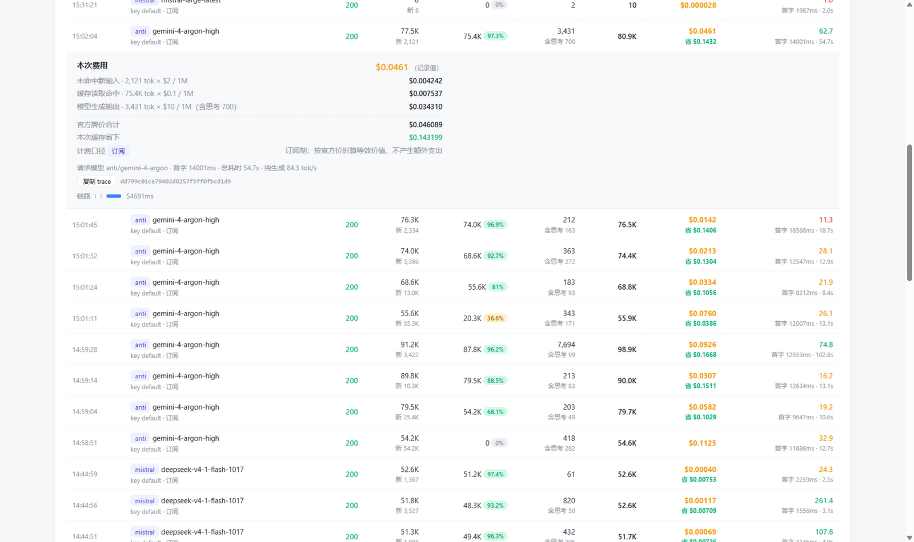
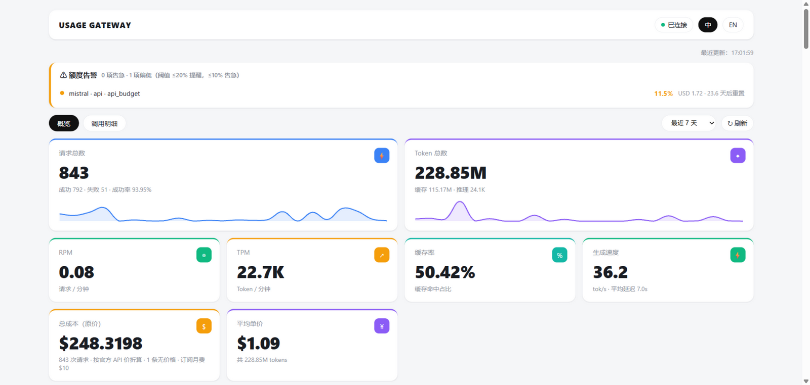
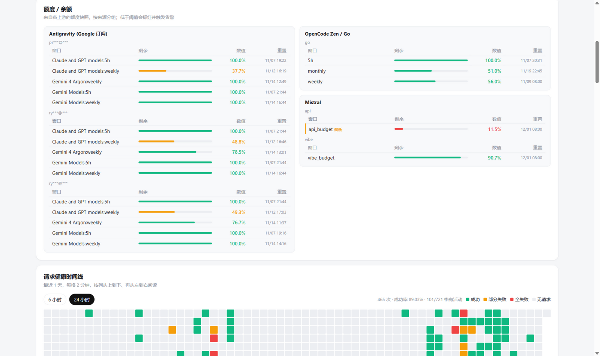
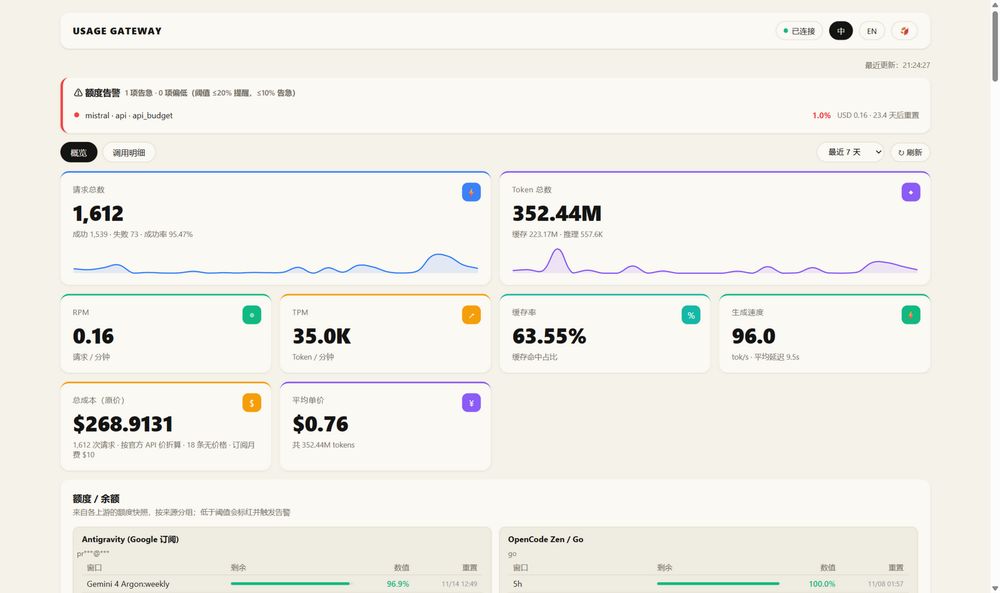
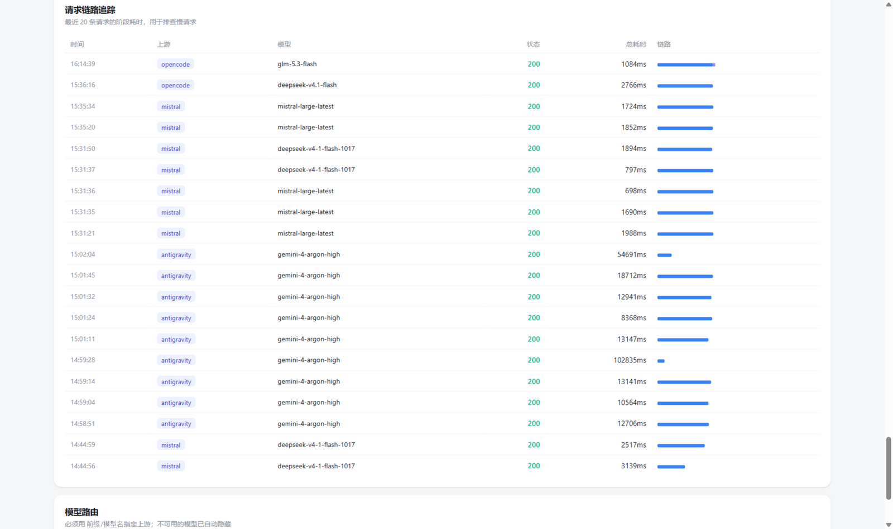
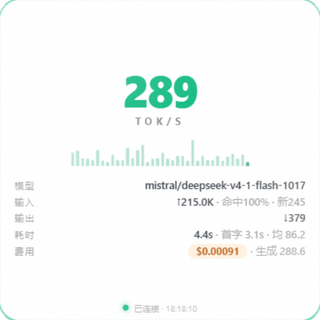

# Usage Gateway

[English](README.en.md)

[](https://github.com/Qiongkura/usage-gateway/actions/workflows/ci.yml)


本地优先的多上游 LLM 网关：**客户端只认你发的 key，上游 key 永不外泄**；每一次调用的
token / 缓存命中 / 费用都被逐笔记录，配一个自带「调用明细」账本的 Web 看板。

```text
客户端 (OpenAI / Anthropic SDK)                上游
      │  sk-gw-xxxx                 ┌──────────────────────────────┐
      ▼                             │  Antigravity Tools  (订阅)   │
┌──────────────────┐   按前缀路由    │  Mistral API        (订阅)   │
│  usage-gateway   │ ─────────────▶ │  OpenCode Zen       (订阅)   │
│  :9000           │                │  New API 兼容中转   (免费)   │
└──────────────────┘                │  ...自定义                   │
      │        ▲                    └──────────────────────────────┘
      │        └── 采集器：额度/余额快照、本地客户端日志
      ▼
  Web 看板 + SQLite（逐笔账单 / 链路追踪 / 热力图 / 告警）
```

## 界面

**逐笔账本：点开任意一行，单次费用分项与「这次缓存帮你省了多少钱」一目了然**



**概览：统计卡、趋势图、365 天活跃热力图**



**订阅额度多账号窗口（本地采集器自动同步，含 5h / 周窗口与重置时间）**



**暖纸主题（浅色 / 深色 / 暖纸三套主题一键切换）**



**链路追踪：每笔请求各阶段耗时，排查慢请求**



**tok/s 悬浮小窗（无边框、真置顶、可拖动 / 锁定 / 关闭）：实时生成速度 + 最近一笔的 token 与费用**



## 特性

**代理核心**
- OpenAI 与 Anthropic 协议兼容（`/v1/chat/completions`、`/v1/messages`、`/v1/responses`、`/v1/models`）
- 模型必须带 `前缀/模型名`，按前缀路由；不带前缀直接拒绝，防止「便宜渠道挂了偷偷跑到贵渠道」
- 严格模式默认关闭故障转移；可选开启同别名分组 + 加权分流 + 重试
- 上游健康熔断（连续失败 3 次冷却，指数退避），400/422 等客户端错误不计熔断
- 兼容层：压平数组型 `content`/`reasoning`、规范 `tool_calls` 分片、`developer` 角色改写、
  严格 schema 上游的参数白名单 / 改名、流式自动注入 `include_usage`、
  不支持流式的上游自动降级非流式再包装成 SSE
- 上游连接池复用（保活 5 分钟），交互式使用首字延迟更低
- 上游多 key 轮换：402 / 429 自动切到下一个 key，15 分钟冷却后恢复；单 key 配置完全兼容
- 定期探测上游模型并热应用结果；确认缺失的模型会被隐藏，无需重启。探针直接向上游发送真实的最小生成请求，可能产生费用或消耗额度；`probe_days` 默认 7，设为 0 关闭自动探测（不影响手动探测）。冷却和共享探针锁存于 `data_dir`，多实例需持久挂载同一目录并运行支持共享锁的版本；跨主机文件系统还须正确支持操作系统文件锁。项目根目录的旧锁仍用于兼容同目录旧进程，但不同项目目录的旧版本不受共享锁保护。健康快照仍存于各项目根目录，不会自动同步到其他实例；共享数据库水位也不会同步这些实例的热应用结果。

**计量与账本**
- 每一笔调用记录：未命中输入 / 缓存读 / 缓存写 / 输出（含思考 token）/ 状态码 / 首字与总耗时 / tok/s
- 单次费用 + 点开展开**分项账单**：输入费 + 缓存读费 + 缓存写费 + 输出费 × 时段倍率，
  以及**这一次缓存帮你省了多少钱**
- 看板「调用明细」Tab：多维筛选（时间 / 渠道 / Key / 来源 / 状态 / 模型搜索）、
  筛选集汇总条、分页、CSV 导出、自动刷新
- 成本一律按官方 API 原价折算；订阅 / 免费渠道只打标签，token 价值照常统计
- 上游自报成本（如 Zen 的 `list_cost`）优先采用；历史记录价格变更后可回填
- 每日自动滚动备份数据库（`VACUUM INTO`，保留 7 份）

**看板**
- 汇总卡片、Token 构成 / 成本 / 请求趋势图、365 天活跃热力图、请求健康时间线
- 额度 / 余额紧凑卡片（多渠道多账号窗口）、额度告警（桌面通知 + webhook，状态机 + 冷却防刷屏）
- **燃烧率预测**：按各窗口自己的周期算「百分点 / 小时」，结合重置时间给出「重置前预计剩余」；
  预计在重置前耗尽时可提前预警；没有重置时间时显示未考虑重置的线性估算。
  5h / 周 / 月窗口不再拿百分比硬折天数（5h 剩 99% 不代表还能用几十天）。预测依据近期快照线性外推，样本不足、过期或跨重置时不外推；突发用量或上游重置行为可能使结果失准，不是额度保证。
- 金额余额阈值可按来源和币种配置，默认关闭；中转站的累计支出不是剩余余额，不触发余额告警。未知或过期额度不计入正常数，`/api/alerts` 通过 `counts.unknown` 报告。关闭通知不改变 `/api/quota` 使用的已配置分类阈值。
- 请求链路追踪（阶段耗时瀑布）、实时 tok/s 悬浮小窗（无边框置顶原生窗，`/float`）
- 浅色 / 深色 / 暖纸三套主题 + 中 / EN 双语，选择本地持久化

**采集器体系**（只读，不碰上游数据）
- Antigravity Tools（SQLite token 用量 + 各账号额度窗口）
- Mistral billing（API / Vibe 预算）、OpenCode Zen（5h / 周 / 月窗口）
- OpenCode CLI 本地数据库、Vibe 会话日志（按累计快照的增量入账；Vibe 字段异步更新或采集去重可能影响准确性）

## 快速开始

要求 Python ≥ 3.10。推荐用 [uv](https://docs.astral.sh/uv/)：

```bash
git clone https://github.com/<you>/usage-gateway.git
cd usage-gateway
uv sync                      # 或 pip install -e .
cp config.example.yaml config.yaml   # 填入你的上游 key 与客户端 key
uv run python -m app.main
```

打开 http://127.0.0.1:9000 即是看板；API 文档在 `/docs`。

默认以明文 HTTP 只监听 `127.0.0.1`，没有内置用户体系或传输加密。可分别配置 `server.stats_key` 保护统计接口、`server.admin_key` 保护管理端点、诊断导出和上游重置。回环监听时密钥可留空；一旦 `server.host` 改为 `0.0.0.0`、局域网地址或其他非回环地址，缺少对应密钥的接口会返回 503，而不是开放访问。两者与客户端 key 权限独立。不要直接暴露到网络；如需远程访问，还须配置可信反向代理的认证、TLS 和访问控制，并更换示例客户端 key。

非 ASCII 密钥请以 UTF-8 百分号编码，通过 `X-Stats-Key-Encoded` 或 `X-Admin-Key-Encoded` 发送（JavaScript 使用 `encodeURIComponent`）；原 `X-Stats-Key` / `X-Admin-Key` ASCII 明文用法仍兼容。编码头优先；管理密钥 URL 参数仅为兼容保留，不推荐使用，因为 URL 可能被日志记录。编码不是加密，远程访问须使用 TLS。

### Windows：开机自启 + 一键打开

在启动文件夹放一个静默启动脚本（`Win+R` → `shell:startup` → 新建 `usage-gateway.vbs`）：

```vbs
Set shell = CreateObject("WScript.Shell")
shell.CurrentDirectory = "C:\path\to\usage-gateway"
shell.Run "cmd /c if not exist logs mkdir logs", 0, True
shell.Run "cmd /c uv run python -m app.main >> logs\gateway.log 2>&1", 0, False
```

登录后网关自动在后台运行（第二个实例会因端口占用自动退出，可放心重复执行）。
再给桌面建一个指向 `http://127.0.0.1:9000/` 的快捷方式即可一键打开；
用 Edge/Chrome 的 `--app=http://127.0.0.1:9000/` 模式可以得到无地址栏的独立窗口。

## Docker

```bash
cp config.example.yaml config.yaml
# 编辑 config.yaml：设置密钥，并将 server.host 改为 0.0.0.0 以监听容器网络
docker compose up -d --build
```

Compose 挂载 `./data`（账本数据库）与已有的 `./config.yaml`；请先创建配置文件，避免 Docker 将缺失的绑定源创建成目录。默认只发布到宿主机 `127.0.0.1:9000`。容器内的 `server.host` 需要设为 `0.0.0.0`，此时必须同时设置 `server.stats_key` 与 `server.admin_key`；缺少任一项时对应接口会失败关闭并返回 503。配置或密钥更改后运行 `docker compose restart`。如需从其他主机访问，应显式调整端口映射，并通过带认证、TLS 和访问控制的反向代理接入。

`/api/health` 是公开存活检查；`/api/ready` 还会检查数据库和采集调度器，Docker 健康检查使用后者。两者都不返回密钥、配置或数据库内容。

构建上下文会排除默认数据目录、配置、密钥和常见凭据文件。若将数据或凭据放在项目内的其他自定义路径，构建前还须自行将这些路径加入 `.dockerignore`，或移到项目目录以外；未被排除的文件会发送给构建器，即使 Dockerfile 没有复制它们。

## 客户端接入

任意 OpenAI SDK：

```python
from openai import OpenAI

client = OpenAI(base_url="http://127.0.0.1:9000/v1", api_key="sk-gw-default-0001")
client.chat.completions.create(model="opgo/kimi-k3", messages=[...])   # 模型必须带前缀
```

Anthropic SDK / Claude Code：

```bash
export ANTHROPIC_BASE_URL=http://127.0.0.1:9000
export ANTHROPIC_API_KEY=sk-gw-default-0001
```

## 配置

完整字段见 [config.example.yaml](config.example.yaml)，要点：

| 配置 | 说明 |
|---|---|
| `gateway.client_keys[].allow_models` | 给每个客户端 key 设模型白名单（比如只许用便宜模型） |
| `upstreams[].alias` | 模型前缀别名，`alias: opgo` → 客户端写 `opgo/kimi-k3` |
| `upstreams[].billing_mode` | `payg` 按量 / `subscription` 订阅（等效价值）/ `free` |
| `upstreams[].api_keys` | 同渠道多 key：`api_key` 优先，402 / 429 时按顺序切下一个，冷却 15 分钟 |
| `upstreams[].no_proxy` | 本地上游直连，不走全局代理 |
| `proxy` | 访问境外上游用的代理，留空读环境变量 |
| `failover` / `retry_rounds` | 故障转移，默认**关闭**（失败立即报错，不静默换渠道） |
| `retention_days` | 用量记录保留天数（默认 365，0 = 永久）；额度快照留 3 天、链路留 7 天 |
| `probe_days` | 自动模型探测间隔，默认 7 天；0 关闭自动探测，探针会产生真实上游用量 |
| `server.admin_key` | 管理、诊断导出和上游重置的独立密钥，推荐使用 `X-Admin-Key` 请求头；远端监听时必填 |
| `server.stats_key` | 统计读取密钥；配置后看板需输入，通过 `X-Stats-Key` 发送；远端监听时必填 |
| `sse_heartbeat_sec` | SSE 心跳间隔，默认 0 关闭；不能消除上游等待或硬超时 |
| `alerts.*` | 额度告警阈值、冷却、忽略窗口、桌面 / webhook 通知 |

## 计费口径（避免算错）

OpenAI 的 `prompt_tokens` **包含**缓存命中的部分，直接拿它算输入费会重复计费。网关统一归一化：

```text
input_tokens  = prompt_tokens - cached_tokens    # 未命中，按输入价
cache_read    = cached_tokens                    # 命中，按缓存价（通常便宜 10~20 倍）
cache_write   = cache_creation_input_tokens      # 写入，按缓存写价
output_tokens = completion_tokens（补齐缺失的 reasoning_tokens）
```

Prompt cache 对长上下文成本影响巨大（实测同一场景差 30~55 倍）。
对用 session 头做缓存路由的上游（OpenCode Zen），网关使用稳定的缓存路由键；实际缓存命中仍取决于上游。

### 会话归属与数据保留

客户端可显式发送单个 `X-Session-ID`，取值为 1–128 个 ASCII 字符，只允许字母、数字、`.`、`_`、`~`、`-`；无效或重复的头会被拒绝（400）。网关以认证后的客户端名称、来源和该 ID 计算 HMAC-SHA256 指纹，存储指纹而非原始 ID，且不将该头转发给上游。这与 Zen 的缓存路由头是两回事。未带该头的请求以及没有会话指纹的历史或采集记录归入「未归属」，不会猜测或追溯归属。

启动时会检查有效的 `gateway.client_keys` 的最终名称是否唯一，否则拒绝加载配置；比较区分大小写，不去除空格，未设置或为空的名称仍按原规则使用 `key-<列表索引>`，无 key 的条目仍被忽略。包括默认名称与显式名称在内的重复名称都必须在升级前改为唯一值；错误信息不输出名称或密钥。已有唯一名称的配置和指纹不变；改名会使该客户端之后的指纹无法与旧名称的记录关联，也不会修复已合并的历史记录。

`/api/sessions` 聚合筛选范围内的记录：`cost_recorded_usd` 只合计已记录的成本，不对缺失成本补算；`unpriced_requests` 给出缺价记录数，因此总额不一定完整，也不代表实际上游账单。

默认用量保留 365 天（`retention_days: 0` 仅关闭用量清理），额度快照保留 3 天、链路保留 7 天；清理定期执行，并非精确到期删除。每日数据库快照在数据目录的 `backups/` 中滚动保留 7 份，旧备份可能仍含已清理的数据。会话密钥位于数据目录的 `session-attribution.key`，数据库快照不包含它；须将密钥与数据库一起安全备份、恢复并限制访问，Windows 需设置目录 ACL。删除或更换密钥会使新指纹无法与旧记录关联。

## API 一览

| 端点 | 说明 |
|---|---|
| `GET /` | Web 看板（概览 / 调用明细双 Tab） |
| `GET /float` | 实时 tok/s 悬浮小窗 |
| `GET /api/health` / `GET /api/ready` | 公开存活检查 / 数据库与调度器就绪检查 |
| `GET /api/logs` | 逐笔调用明细（筛选 + 分页 + 单次费用分项），见下方参数 |
| `GET /api/sessions` | 按会话指纹汇总已记录成本和缺价数（默认网关记录） |
| `GET /api/diagnostics?limit=50` | 下载白名单诊断 JSON（1–500 条，默认 50）；使用管理鉴权 |
| `GET /api/summary?range=today\|7d\|30d\|all` | 汇总 |
| `GET /api/usage?group_by=model\|source\|account\|client_key` | 分组统计 |
| `GET /api/timeseries?bucket=hour\|day` | 时间序列 |
| `GET /api/costs` / `GET /api/pricing` | 成本明细 / 当前价格表 |
| `GET /api/speed` | 最近调用速度明细（纯生成 tok/s、首字、总耗时） |
| `GET /api/heatmap` / `GET /api/health-timeline` | 365 天热力图 / 请求健康时间线 |
| `GET /api/traces` / `GET /api/traces/{id}` | 链路追踪 |
| `GET /api/quota` / `GET /api/alerts` | 额度快照（含燃烧率预测）/ 告警状态 |
| `GET /api/balance` / `GET /api/models/active` / `GET /api/routes` | 余额 / 活跃模型 / 路由表 |
| `GET /api/upstreams/health` | 上游健康与熔断状态 |
| `POST /api/upstreams/{name}/reset` | 手动重置某个上游的熔断 |
| `POST /api/admin/checkpoint` / `POST /api/admin/shutdown` | 优雅落盘 / 关闭（回环可免密，远端必须配置 admin_key） |

`/api/logs` 常用参数：`range`、`source`、`model`（模糊）、`client_key`、
`status=success|error`、`origin=gateway|collector|all`、`page`、`page_size`；可用 `session_key` 或 `unassigned=true` 筛选会话。

诊断导出仅选择经过校验的时间、状态、耗时及有限的阶段和用量元数据，不导出原始请求内容、标识符或错误文本，也不重放请求。导出仍可能泄露活动时间和用量，应审查并安全保存后再分享。回环监听且未设置 `server.admin_key` 时无需鉴权；非回环监听未配置管理密钥时接口返回 503。链路和其他统计接口有独立暴露面，不能把诊断导出白名单当作全站脱敏保证。

## 项目结构

```text
app/
  main.py            # 入口：路由、 lifespan、采集器装配
  proxy.py           # 转发核心：兼容层、SSE 归一化、计量、连接池
  pricing.py         # 价格表 + 单次费用分项拆解（含时段倍率、缓存节省额）
  db.py              # SQLite（WAL）：用量 / 额度 / 链路 / 水位线 / 保留清理
  api/stats.py       # 统计 API（含 /api/logs 账本）
  scheduler.py       # 定时采集、清理 / 备份、燃烧率计算、每周模型探测
  probe_models.py    # 上游模型可用性探测（结果热应用）
  collectors/        # 只读采集器（额度 + 本地客户端日志）
  alerts.py          # 告警状态机与通知渠道
  health.py          # 熔断与负载均衡
  tracing.py         # 请求链路
float_app.py         # tok/s 悬浮窗（pywebview 无边框原生窗）
web/                 # 零依赖单页看板（Chart.js 本地打包，三套主题）
tests/               # 单元测试（兼容层 / 账本 / 燃烧率 / 维护功能）
Dockerfile           # uv 基础镜像 + 健康检查
docker-compose.yml   # 数据 / 配置 / 日志挂载
```

## 测试

```bash
python -m unittest discover -s tests
node tests/test_web_escape.cjs  # 前端离线回归，需要 Node.js
node tests/test_float.cjs        # 悬浮窗离线回归
```

测试覆盖：SSE 兼容归一化（跨 TCP 分片、空预热帧、数组 content、tool_calls 分片）、
请求体改写、`/api/logs` 账本与费用补算、价格分项、多 key 轮换、流式代理、
燃烧率预测与重置前预警、保留清理 / 备份、vibe 增量采集、管理鉴权。

## 已知限制

- 模型须指定上游前缀；若多个上游使用相同前缀或名称，按配置顺序匹配第一个。流式 usage 依赖上游返回，个别上游不回 token 时按启发式估算并打「估算」标记
- 燃烧率是「按最近一段样本线性外推」，突发流量下只作参考；有重置时间的窗口会同时给出重置前预计值。若采集从未提供重置时间，且重置后的剩余百分比没有明显回升，网关无法可靠识别重置。
- 流式响应已开始后发生上游读取错误时，会记录 `stream_interrupted`，但部分客户端可能只看到 HTTP 200 和提前结束，无法仅凭状态码识别；客户端应检查协议终止事件。数据库写入失败会记录错误，但无法保证失败请求已入账或自动补偿。代理接管后若在写入前发生未预期异常，为避免重复记账不会盲目补写；响应中的 trace ID 此时仅用于查找日志，可能没有对应的数据库记录。
- 看板 / `/api` 无用户体系，按单机自用设计；对外暴露请自行加反代认证
- Windows 下开发为主，Linux/macOS 理论可用（桌面通知仅 Windows）

## License

[MIT](LICENSE)
